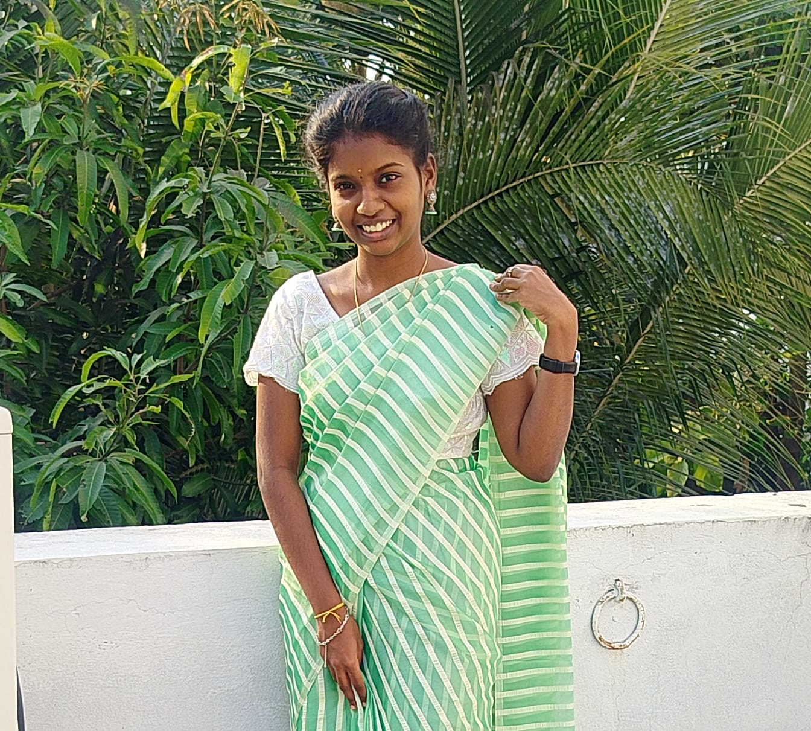
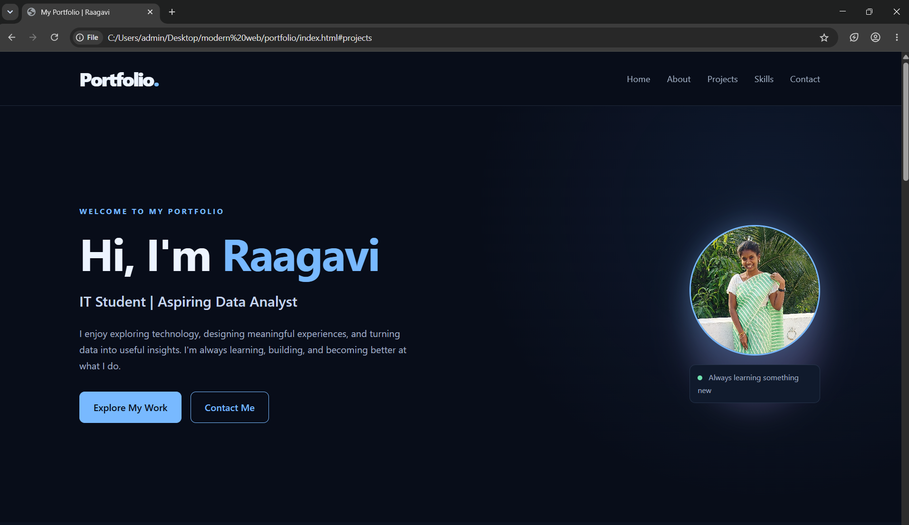
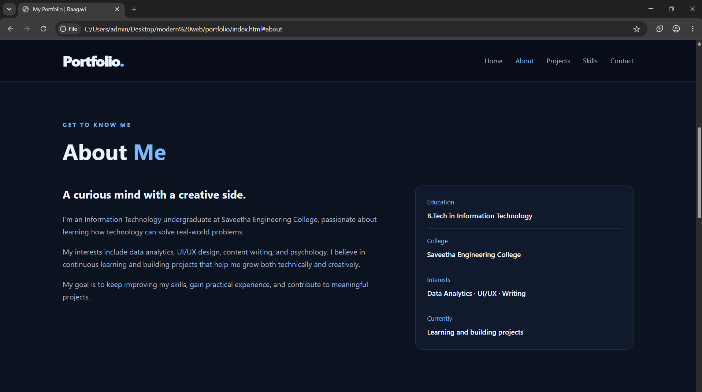
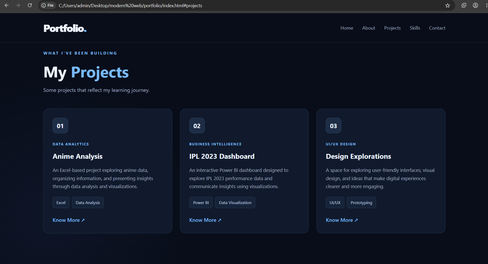
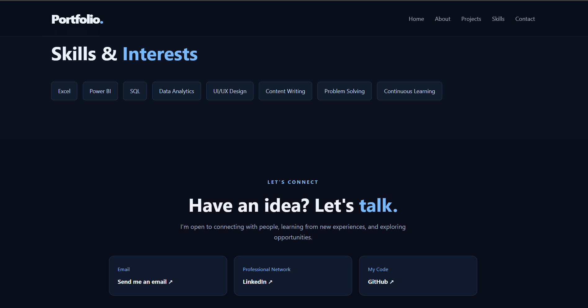

# Portfolio
# Ex01 Portfolio
# Date: 28-10-2026
# AIM
To create a Portfolio using HTML and CSS.

# ALGORITHM
STEP 1
Create an HTML file (index.html)

STEP 2
Create a CSS file (style.css)

STEP 3
Include a navigation bar with links to different sections.

STEP 4
Add structured sections for introduction, about, projects, and contact details.

STEP 5
Define global styles for fonts, colors, and layout.

STEP 6
Style the header, navigation bar, and sections.

STEP 7
Use Flexbox or CSS Grid for layout design.

STEP 8
Add hover effects and transitions for interactivity.

STEP 9
Add Images and Media.

STEP 10
Use optimized images for a professional look.

STEP 11
Open the HTML file in a browser to check layout and functionality.

STEP 12
Fix styling issues and refine content placement.

STEP 13
Deploy the Portfolio.

STEP 14
Upload to GitHub Pages for free hosting.

# PROGRAM
## index.html
```

<!DOCTYPE html>
<html lang="en">
<head>
    <meta charset="UTF-8">
    <meta name="viewport" content="width=device-width, initial-scale=1.0">
    <meta name="description" content="Personal portfolio of an Information Technology student interested in design, data analytics and technology.">

    <title>My Portfolio | Raagavi</title>

    <link rel="stylesheet" href="style.css">
</head>

<body>

    <!-- Navigation Bar -->
    <header class="navbar">
        <a href="#home" class="logo">Portfolio<span>.</span></a>

        <nav>
            <a href="#home">Home</a>
            <a href="#about">About</a>
            <a href="#projects">Projects</a>
            <a href="#skills">Skills</a>
            <a href="#contact">Contact</a>
        </nav>
    </header>

    <main>

        <!-- Introduction Section -->
        <section id="home" class="hero section">
            <div class="hero-content">
                <p class="eyebrow">WELCOME TO MY PORTFOLIO</p>

                <h1>Hi, I'm <span>Raagavi</span></h1>

                <h2>IT Student | Aspiring Data Analyst</h2>

                <p class="hero-description">
                    I enjoy exploring technology, designing meaningful
                    experiences, and turning data into useful insights.
                    I'm always learning, building, and becoming better
                    at what I do.
                </p>

                <div class="hero-buttons">
                    <a href="#projects" class="btn primary-btn">
                        Explore My Work
                    </a>

                    <a href="#contact" class="btn secondary-btn">
                        Contact Me
                    </a>
                </div>
            </div>

            <!-- Replace photo.jpg with your own photo filename -->
            <div class="hero-image">
                <div class="image-glow"></div>

                

                <div class="image-caption">
                    <span class="status-dot"></span>
                    Always learning something new
                </div>
            </div>
        </section>

        <!-- About Section -->
        <section id="about" class="section about-section">
            <div class="section-heading">
                <p class="eyebrow">GET TO KNOW ME</p>
                <h2>About <span>Me</span></h2>
            </div>

            <div class="about-content">
                <div class="about-text">
                    <h3>A curious mind with a creative side.</h3>

                    <p>
                        I'm an Information Technology undergraduate at
                        Saveetha Engineering College, passionate about
                        learning how technology can solve real-world
                        problems.
                    </p>

                    <p>
                        My interests include data analytics, UI/UX design,
                        content writing, and psychology. I believe in
                        continuous learning and building projects that
                        help me grow both technically and creatively.
                    </p>

                    <p>
                        My goal is to keep improving my skills, gain
                        practical experience, and contribute to meaningful
                        projects.
                    </p>
                </div>

                <div class="about-card">
                    <div class="info-item">
                        <span>Education</span>
                        <strong>B.Tech in Information Technology</strong>
                    </div>

                    <div class="info-item">
                        <span>College</span>
                        <strong>Saveetha Engineering College</strong>
                    </div>

                    <div class="info-item">
                        <span>Interests</span>
                        <strong>Data Analytics · UI/UX · Writing</strong>
                    </div>

                    <div class="info-item">
                        <span>Currently</span>
                        <strong>Learning and building projects</strong>
                    </div>
                </div>
            </div>
        </section>

        <!-- Projects Section -->
        <section id="projects" class="section projects-section">
            <div class="section-heading">
                <p class="eyebrow">WHAT I'VE BEEN BUILDING</p>
                <h2>My <span>Projects</span></h2>
                <p>Some projects that reflect my learning journey.</p>
            </div>

            <div class="project-grid">

                <article class="project-card">
                    <div class="project-icon">01</div>

                    <p class="project-category">DATA ANALYTICS</p>

                    <h3>Anime Analysis</h3>

                    <p>
                        An Excel-based project exploring anime data,
                        organizing information, and presenting insights
                        through data analysis and visualizations.
                    </p>

                    <div class="tags">
                        <span>Excel</span>
                        <span>Data Analysis</span>
                    </div>

                    <!-- Add your actual project URL here -->
                    <a href="#contact" class="project-link">
                        Know More ↗
                    </a>
                </article>

                <article class="project-card">
                    <div class="project-icon">02</div>

                    <p class="project-category">BUSINESS INTELLIGENCE</p>

                    <h3>IPL 2023 Dashboard</h3>

                    <p>
                        An interactive Power BI dashboard designed
                        to explore IPL 2023 performance data and
                        communicate insights using visualizations.
                    </p>

                    <div class="tags">
                        <span>Power BI</span>
                        <span>Data Visualization</span>
                    </div>

                    <!-- Add your actual project URL here -->
                    <a href="#contact" class="project-link">
                        Know More ↗
                    </a>
                </article>

                <article class="project-card">
                    <div class="project-icon">03</div>

                    <p class="project-category">UI/UX DESIGN</p>

                    <h3>Design Explorations</h3>

                    <p>
                        A space for exploring user-friendly interfaces,
                        visual design, and ideas that make digital
                        experiences clearer and more engaging.
                    </p>

                    <div class="tags">
                        <span>UI/UX</span>
                        <span>Prototyping</span>
                    </div>

                    <!-- Replace with your design project URL -->
                    <a href="#contact" class="project-link">
                        Know More ↗
                    </a>
                </article>

            </div>
        </section>

        <!-- Skills Section -->
        <section id="skills" class="section skills-section">
            <div class="section-heading">
                <p class="eyebrow">MY TOOLKIT</p>
                <h2>Skills & <span>Interests</span></h2>
            </div>

            <div class="skills-list">
                <span>Excel</span>
                <span>Power BI</span>
                <span>SQL</span>
                <span>Data Analytics</span>
                <span>UI/UX Design</span>
                <span>Content Writing</span>
                <span>Problem Solving</span>
                <span>Continuous Learning</span>
            </div>
        </section>

        <!-- Contact Section -->
        <section id="contact" class="section contact-section">
            <div class="section-heading">
                <p class="eyebrow">LET'S CONNECT</p>
                <h2>Have an idea? Let's <span>talk.</span></h2>

                <p>
                    I'm open to connecting with people, learning from
                    new experiences, and exploring opportunities.
                </p>
            </div>

            <div class="contact-links">
                <!-- Replace these example details with your own -->
                <a href="mailto:your.email@example.com" class="contact-card">
                    <span>Email</span>
                    <strong>Send me an email ↗</strong>
                </a>

                <a
                    href="https://www.linkedin.com/"
                    target="_blank"
                    rel="noopener noreferrer"
                    class="contact-card"
                >
                    <span>Professional Network</span>
                    <strong>LinkedIn ↗</strong>
                </a>

                <a
                    href="https://github.com/"
                    target="_blank"
                    rel="noopener noreferrer"
                    class="contact-card"
                >
                    <span>My Code</span>
                    <strong>GitHub ↗</strong>
                </a>
            </div>
        </section>

    </main>

    <!-- Footer -->
    <footer class="footer">
        <p>Designed with care by Raagavi R M</p>
        <p>© 2026</p>
    </footer>

</body>
</html>


```
## style.css:
```

/* ---------- Global Styles ---------- */

:root {
    --background: #080d19;
    --surface: #101a2c;
    --surface-light: #16243a;
    --primary: #78b9ff;
    --secondary: #c3a6ff;
    --text: #edf4ff;
    --muted: #a2b0c5;
    --border: rgba(148, 180, 225, 0.16);
}

* {
    margin: 0;
    padding: 0;
    box-sizing: border-box;
    scroll-behavior: smooth;
}

body {
    font-family: "Segoe UI", Arial, sans-serif;
    background: var(--background);
    color: var(--text);
    line-height: 1.7;
    overflow-x: hidden;
}

a {
    color: inherit;
    text-decoration: none;
}

img {
    display: block;
    max-width: 100%;
}

span {
    color: var(--primary);
}

.section {
    padding: 100px 9%;
    scroll-margin-top: 75px;
}

/* ---------- Navigation Bar ---------- */

.navbar {
    width: 100%;
    min-height: 75px;
    padding: 18px 9%;
    display: flex;
    align-items: center;
    justify-content: space-between;
    gap: 24px;
    background: rgba(8, 13, 25, 0.92);
    border-bottom: 1px solid var(--border);
    position: sticky;
    top: 0;
    z-index: 100;
    backdrop-filter: blur(14px);
}

.logo {
    font-size: 2rem;
    font-weight: 800;
    letter-spacing: -2px;
}

.navbar nav {
    display: flex;
    align-items: center;
    gap: 28px;
    flex-wrap: wrap;
}

.navbar nav a {
    font-size: 0.92rem;
    color: var(--muted);
    transition: color 0.3s ease;
}

.navbar nav a:hover {
    color: var(--primary);
}

/* ---------- Introduction / Hero ---------- */

.hero {
    min-height: 85vh;
    display: flex;
    align-items: center;
    justify-content: space-between;
    gap: 65px;
    background:
        radial-gradient(
            circle at 85% 25%,
            rgba(67, 119, 207, 0.12),
            transparent 35%
        );
}

.hero-content {
    flex: 1.2;
}

.eyebrow {
    color: var(--primary);
    font-size: 0.78rem;
    font-weight: 700;
    letter-spacing: 3px;
    margin-bottom: 16px;
}

.hero h1 {
    font-size: clamp(2.7rem, 5vw, 4.7rem);
    line-height: 1.15;
    margin-bottom: 18px;
    letter-spacing: -2px;
}

.hero h2 {
    color: #c5d5ed;
    font-size: clamp(1.1rem, 2vw, 1.5rem);
    font-weight: 500;
    margin-bottom: 20px;
}

.hero-description {
    color: var(--muted);
    max-width: 560px;
    margin-bottom: 30px;
}

.hero-buttons {
    display: flex;
    flex-wrap: wrap;
    gap: 15px;
}

.btn {
    display: inline-block;
    padding: 12px 23px;
    border-radius: 9px;
    font-weight: 600;
    border: 1px solid var(--primary);
    transition:
        transform 0.3s ease,
        background 0.3s ease,
        box-shadow 0.3s ease;
}

.primary-btn {
    background: var(--primary);
    color: #07101f;
}

.secondary-btn {
    color: var(--primary);
}

.btn:hover {
    transform: translateY(-4px);
    box-shadow: 0 8px 25px rgba(120, 185, 255, 0.15);
}

.secondary-btn:hover {
    background: rgba(120, 185, 255, 0.1);
}

/* ---------- Profile Photo ---------- */


/* Smaller circular profile photo */
.hero-image {
    flex: 0 0 220px;
    width: 220px;
    max-width: 220px;
    position: relative;
    margin: 15px auto;
}

.image-glow {
    position: absolute;
    inset: -8px;
    background: linear-gradient(
        135deg,
        var(--primary),
        var(--secondary)
    );
    border-radius: 50%;
    filter: blur(25px);
    opacity: 0.25;
}

.profile-photo {
    position: relative;
    width: 220px;
    height: 220px;
    aspect-ratio: 1 / 1;
    object-fit: cover;
    object-position: center;
    border-radius: 50%;
    border: 3px solid var(--primary);
    box-shadow: 0 10px 35px rgba(120, 185, 255, 0.15);
    transition: transform 0.4s ease;
}

.profile-photo:hover {
    transform: scale(1.05);
}

/* Smaller photo on mobile screens */
@media (max-width: 700px) {
    .hero-image {
        flex: 0 0 180px;
        width: 180px;
        max-width: 180px;
    }

    .profile-photo {
        width: 180px;
        height: 180px;
    }
}


/* Smaller circular profile photo */
.hero-image {
    flex: 0 0 220px;
    width: 220px;
    max-width: 220px;
    position: relative;
    margin: 15px auto;
}

.image-glow {
    position: absolute;
    inset: -8px;
    background: linear-gradient(
        135deg,
        var(--primary),
        var(--secondary)
    );
    border-radius: 50%;
    filter: blur(25px);
    opacity: 0.25;
}

.profile-photo {
    position: relative;
    width: 220px;
    height: 220px;
    aspect-ratio: 1 / 1;
    object-fit: cover;
    object-position: center;
    border-radius: 50%;
    border: 3px solid var(--primary);
    box-shadow: 0 10px 35px rgba(120, 185, 255, 0.15);
    transition: transform 0.4s ease;
}

.profile-photo:hover {
    transform: scale(1.05);
}

/* Smaller photo on mobile screens */
@media (max-width: 700px) {
    .hero-image {
        flex: 0 0 180px;
        width: 180px;
        max-width: 180px;
    }

    .profile-photo {
        width: 180px;
        height: 180px;
    }
}


/* Smaller circular profile photo */
.hero-image {
    flex: 0 0 220px;
    width: 220px;
    max-width: 220px;
    position: relative;
    margin: 15px auto;
}

.image-glow {
    position: absolute;
    inset: -8px;
    background: linear-gradient(
        135deg,
        var(--primary),
        var(--secondary)
    );
    border-radius: 50%;
    filter: blur(25px);
    opacity: 0.25;
}

.profile-photo {
    position: relative;
    width: 220px;
    height: 220px;
    aspect-ratio: 1 / 1;
    object-fit: cover;
    object-position: center;
    border-radius: 50%;
    border: 3px solid var(--primary);
    box-shadow: 0 10px 35px rgba(120, 185, 255, 0.15);
    transition: transform 0.4s ease;
}

.profile-photo:hover {
    transform: scale(1.05);
}

/* Smaller photo on mobile screens */
@media (max-width: 700px) {
    .hero-image {
        flex: 0 0 180px;
        width: 180px;
        max-width: 180px;
    }

    .profile-photo {
        width: 180px;
        height: 180px;
    }
}


/* Smaller circular profile photo */
.hero-image {
    flex: 0 0 220px;
    width: 220px;
    max-width: 220px;
    position: relative;
    margin: 15px auto;
}

.image-glow {
    position: absolute;
    inset: -8px;
    background: linear-gradient(
        135deg,
        var(--primary),
        var(--secondary)
    );
    border-radius: 50%;
    filter: blur(25px);
    opacity: 0.25;
}

.profile-photo {
    position: relative;
    width: 220px;
    height: 220px;
    aspect-ratio: 1 / 1;
    object-fit: cover;
    object-position: center;
    border-radius: 50%;
    border: 3px solid var(--primary);
    box-shadow: 0 10px 35px rgba(120, 185, 255, 0.15);
    transition: transform 0.4s ease;
}

.profile-photo:hover {
    transform: scale(1.05);
}

/* Smaller photo on mobile screens */
@media (max-width: 700px) {
    .hero-image {
        flex: 0 0 180px;
        width: 180px;
        max-width: 180px;
    }

    .profile-photo {
        width: 180px;
        height: 180px;
    }
}


/* Smaller circular profile photo */
.hero-image {
    flex: 0 0 220px;
    width: 220px;
    max-width: 220px;
    position: relative;
    margin: 15px auto;
}

.image-glow {
    position: absolute;
    inset: -8px;
    background: linear-gradient(
        135deg,
        var(--primary),
        var(--secondary)
    );
    border-radius: 50%;
    filter: blur(25px);
    opacity: 0.25;
}

.profile-photo {
    position: relative;
    width: 220px;
    height: 220px;
    aspect-ratio: 1 / 1;
    object-fit: cover;
    object-position: center;
    border-radius: 50%;
    border: 3px solid var(--primary);
    box-shadow: 0 10px 35px rgba(120, 185, 255, 0.15);
    transition: transform 0.4s ease;
}

.profile-photo:hover {
    transform: scale(1.05);
}

/* Smaller photo on mobile screens */
@media (max-width: 700px) {
    .hero-image {
        flex: 0 0 180px;
        width: 180px;
        max-width: 180px;
    }

    .profile-photo {
        width: 180px;
        height: 180px;
    }
}


/* Smaller circular profile photo */
.hero-image {
    flex: 0 0 220px;
    width: 220px;
    max-width: 220px;
    position: relative;
    margin: 15px auto;
}

.image-glow {
    position: absolute;
    inset: -8px;
    background: linear-gradient(
        135deg,
        var(--primary),
        var(--secondary)
    );
    border-radius: 50%;
    filter: blur(25px);
    opacity: 0.25;
}

.profile-photo {
    position: relative;
    width: 220px;
    height: 220px;
    aspect-ratio: 1 / 1;
    object-fit: cover;
    object-position: center;
    border-radius: 50%;
    border: 3px solid var(--primary);
    box-shadow: 0 10px 35px rgba(120, 185, 255, 0.15);
    transition: transform 0.4s ease;
}

.profile-photo:hover {
    transform: scale(1.05);
}

/* Smaller photo on mobile screens */
@media (max-width: 700px) {
    .hero-image {
        flex: 0 0 180px;
        width: 180px;
        max-width: 180px;
    }

    .profile-photo {
        width: 180px;
        height: 180px;
    }
}


/* Smaller circular profile photo */
.hero-image {
    flex: 0 0 220px;
    width: 220px;
    max-width: 220px;
    position: relative;
    margin: 15px auto;
}

.image-glow {
    position: absolute;
    inset: -8px;
    background: linear-gradient(
        135deg,
        var(--primary),
        var(--secondary)
    );
    border-radius: 50%;
    filter: blur(25px);
    opacity: 0.25;
}

.profile-photo {
    position: relative;
    width: 220px;
    height: 220px;
    aspect-ratio: 1 / 1;
    object-fit: cover;
    object-position: center;
    border-radius: 50%;
    border: 3px solid var(--primary);
    box-shadow: 0 10px 35px rgba(120, 185, 255, 0.15);
    transition: transform 0.4s ease;
}

.profile-photo:hover {
    transform: scale(1.05);
}

/* Smaller photo on mobile screens */
@media (max-width: 700px) {
    .hero-image {
        flex: 0 0 180px;
        width: 180px;
        max-width: 180px;
    }

    .profile-photo {
        width: 180px;
        height: 180px;
    }
}


/* Smaller circular profile photo */
.hero-image {
    flex: 0 0 220px;
    width: 220px;
    max-width: 220px;
    position: relative;
    margin: 15px auto;
}

.image-glow {
    position: absolute;
    inset: -8px;
    background: linear-gradient(
        135deg,
        var(--primary),
        var(--secondary)
    );
    border-radius: 50%;
    filter: blur(25px);
    opacity: 0.25;
}

.profile-photo {
    position: relative;
    width: 220px;
    height: 220px;
    aspect-ratio: 1 / 1;
    object-fit: cover;
    object-position: center;
    border-radius: 50%;
    border: 3px solid var(--primary);
    box-shadow: 0 10px 35px rgba(120, 185, 255, 0.15);
    transition: transform 0.4s ease;
}

.profile-photo:hover {
    transform: scale(1.05);
}

/* Smaller photo on mobile screens */
@media (max-width: 700px) {
    .hero-image {
        flex: 0 0 180px;
        width: 180px;
        max-width: 180px;
    }

    .profile-photo {
        width: 180px;
        height: 180px;
    }
}


/* Smaller circular profile photo */
.hero-image {
    flex: 0 0 220px;
    width: 220px;
    max-width: 220px;
    position: relative;
    margin: 15px auto;
}

.image-glow {
    position: absolute;
    inset: -8px;
    background: linear-gradient(
        135deg,
        var(--primary),
        var(--secondary)
    );
    border-radius: 50%;
    filter: blur(25px);
    opacity: 0.25;
}

.profile-photo {
    position: relative;
    width: 220px;
    height: 220px;
    aspect-ratio: 1 / 1;
    object-fit: cover;
    object-position: center;
    border-radius: 50%;
    border: 3px solid var(--primary);
    box-shadow: 0 10px 35px rgba(120, 185, 255, 0.15);
    transition: transform 0.4s ease;
}

.profile-photo:hover {
    transform: scale(1.05);
}

/* Smaller photo on mobile screens */
@media (max-width: 700px) {
    .hero-image {
        flex: 0 0 180px;
        width: 180px;
        max-width: 180px;
    }

    .profile-photo {
        width: 180px;
        height: 180px;
    }
}


/* Smaller circular profile photo */
.hero-image {
    flex: 0 0 220px;
    width: 220px;
    max-width: 220px;
    position: relative;
    margin: 15px auto;
}

.image-glow {
    position: absolute;
    inset: -8px;
    background: linear-gradient(
        135deg,
        var(--primary),
        var(--secondary)
    );
    border-radius: 50%;
    filter: blur(25px);
    opacity: 0.25;
}

.profile-photo {
    position: relative;
    width: 220px;
    height: 220px;
    aspect-ratio: 1 / 1;
    object-fit: cover;
    object-position: center;
    border-radius: 50%;
    border: 3px solid var(--primary);
    box-shadow: 0 10px 35px rgba(120, 185, 255, 0.15);
    transition: transform 0.4s ease;
}

.profile-photo:hover {
    transform: scale(1.05);
}

/* Smaller photo on mobile screens */
@media (max-width: 700px) {
    .hero-image {
        flex: 0 0 180px;
        width: 180px;
        max-width: 180px;
    }

    .profile-photo {
        width: 180px;
        height: 180px;
    }
}


/* Smaller circular profile photo */
.hero-image {
    flex: 0 0 220px;
    width: 220px;
    max-width: 220px;
    position: relative;
    margin: 15px auto;
}

.image-glow {
    position: absolute;
    inset: -8px;
    background: linear-gradient(
        135deg,
        var(--primary),
        var(--secondary)
    );
    border-radius: 50%;
    filter: blur(25px);
    opacity: 0.25;
}

.profile-photo {
    position: relative;
    width: 220px;
    height: 220px;
    aspect-ratio: 1 / 1;
    object-fit: cover;
    object-position: center;
    border-radius: 50%;
    border: 3px solid var(--primary);
    box-shadow: 0 10px 35px rgba(120, 185, 255, 0.15);
    transition: transform 0.4s ease;
}

.profile-photo:hover {
    transform: scale(1.05);
}

/* Smaller photo on mobile screens */
@media (max-width: 700px) {
    .hero-image {
        flex: 0 0 180px;
        width: 180px;
        max-width: 180px;
    }

    .profile-photo {
        width: 180px;
        height: 180px;
    }
}


/* Smaller circular profile photo */
.hero-image {
    flex: 0 0 220px;
    width: 220px;
    max-width: 220px;
    position: relative;
    margin: 15px auto;
}

.image-glow {
    position: absolute;
    inset: -8px;
    background: linear-gradient(
        135deg,
        var(--primary),
        var(--secondary)
    );
    border-radius: 50%;
    filter: blur(25px);
    opacity: 0.25;
}

.profile-photo {
    position: relative;
    width: 220px;
    height: 220px;
    aspect-ratio: 1 / 1;
    object-fit: cover;
    object-position: center;
    border-radius: 50%;
    border: 3px solid var(--primary);
    box-shadow: 0 10px 35px rgba(120, 185, 255, 0.15);
    transition: transform 0.4s ease;
}

.profile-photo:hover {
    transform: scale(1.05);
}

/* Smaller photo on mobile screens */
@media (max-width: 700px) {
    .hero-image {
        flex: 0 0 180px;
        width: 180px;
        max-width: 180px;
    }

    .profile-photo {
        width: 180px;
        height: 180px;
    }
}


/* Smaller circular profile photo */
.hero-image {
    flex: 0 0 220px;
    width: 220px;
    max-width: 220px;
    position: relative;
    margin: 15px auto;
}

.image-glow {
    position: absolute;
    inset: -8px;
    background: linear-gradient(
        135deg,
        var(--primary),
        var(--secondary)
    );
    border-radius: 50%;
    filter: blur(25px);
    opacity: 0.25;
}

.profile-photo {
    position: relative;
    width: 220px;
    height: 220px;
    aspect-ratio: 1 / 1;
    object-fit: cover;
    object-position: center;
    border-radius: 50%;
    border: 3px solid var(--primary);
    box-shadow: 0 10px 35px rgba(120, 185, 255, 0.15);
    transition: transform 0.4s ease;
}

.profile-photo:hover {
    transform: scale(1.05);
}

/* Smaller photo on mobile screens */
@media (max-width: 700px) {
    .hero-image {
        flex: 0 0 180px;
        width: 180px;
        max-width: 180px;
    }

    .profile-photo {
        width: 180px;
        height: 180px;
    }
}


/* Smaller circular profile photo */
.hero-image {
    flex: 0 0 220px;
    width: 220px;
    max-width: 220px;
    position: relative;
    margin: 15px auto;
}

.image-glow {
    position: absolute;
    inset: -8px;
    background: linear-gradient(
        135deg,
        var(--primary),
        var(--secondary)
    );
    border-radius: 50%;
    filter: blur(25px);
    opacity: 0.25;
}

.profile-photo {
    position: relative;
    width: 220px;
    height: 220px;
    aspect-ratio: 1 / 1;
    object-fit: cover;
    object-position: center;
    border-radius: 50%;
    border: 3px solid var(--primary);
    box-shadow: 0 10px 35px rgba(120, 185, 255, 0.15);
    transition: transform 0.4s ease;
}

.profile-photo:hover {
    transform: scale(1.05);
}

/* Smaller photo on mobile screens */
@media (max-width: 700px) {
    .hero-image {
        flex: 0 0 180px;
        width: 180px;
        max-width: 180px;
    }

    .profile-photo {
        width: 180px;
        height: 180px;
    }
}


/* Smaller circular profile photo */
.hero-image {
    flex: 0 0 220px;
    width: 220px;
    max-width: 220px;
    position: relative;
    margin: 15px auto;
}

.image-glow {
    position: absolute;
    inset: -8px;
    background: linear-gradient(
        135deg,
        var(--primary),
        var(--secondary)
    );
    border-radius: 50%;
    filter: blur(25px);
    opacity: 0.25;
}

.profile-photo {
    position: relative;
    width: 220px;
    height: 220px;
    aspect-ratio: 1 / 1;
    object-fit: cover;
    object-position: center;
    border-radius: 50%;
    border: 3px solid var(--primary);
    box-shadow: 0 10px 35px rgba(120, 185, 255, 0.15);
    transition: transform 0.4s ease;
}

.profile-photo:hover {
    transform: scale(1.05);
}

/* Smaller photo on mobile screens */
@media (max-width: 700px) {
    .hero-image {
        flex: 0 0 180px;
        width: 180px;
        max-width: 180px;
    }

    .profile-photo {
        width: 180px;
        height: 180px;
    }
}


/* Smaller circular profile photo */
.hero-image {
    flex: 0 0 220px;
    width: 220px;
    max-width: 220px;
    position: relative;
    margin: 15px auto;
}

.image-glow {
    position: absolute;
    inset: -8px;
    background: linear-gradient(
        135deg,
        var(--primary),
        var(--secondary)
    );
    border-radius: 50%;
    filter: blur(25px);
    opacity: 0.25;
}

.profile-photo {
    position: relative;
    width: 220px;
    height: 220px;
    aspect-ratio: 1 / 1;
    object-fit: cover;
    object-position: center;
    border-radius: 50%;
    border: 3px solid var(--primary);
    box-shadow: 0 10px 35px rgba(120, 185, 255, 0.15);
    transition: transform 0.4s ease;
}

.profile-photo:hover {
    transform: scale(1.05);
}

/* Smaller photo on mobile screens */
@media (max-width: 700px) {
    .hero-image {
        flex: 0 0 180px;
        width: 180px;
        max-width: 180px;
    }

    .profile-photo {
        width: 180px;
        height: 180px;
    }
}


/* Smaller circular profile photo */
.hero-image {
    flex: 0 0 220px;
    width: 220px;
    max-width: 220px;
    position: relative;
    margin: 15px auto;
}

.image-glow {
    position: absolute;
    inset: -8px;
    background: linear-gradient(
        135deg,
        var(--primary),
        var(--secondary)
    );
    border-radius: 50%;
    filter: blur(25px);
    opacity: 0.25;
}

.profile-photo {
    position: relative;
    width: 220px;
    height: 220px;
    aspect-ratio: 1 / 1;
    object-fit: cover;
    object-position: center;
    border-radius: 50%;
    border: 3px solid var(--primary);
    box-shadow: 0 10px 35px rgba(120, 185, 255, 0.15);
    transition: transform 0.4s ease;
}

.profile-photo:hover {
    transform: scale(1.05);
}

/* Smaller photo on mobile screens */
@media (max-width: 700px) {
    .hero-image {
        flex: 0 0 180px;
        width: 180px;
        max-width: 180px;
    }

    .profile-photo {
        width: 180px;
        height: 180px;
    }
}


/* Smaller circular profile photo */
.hero-image {
    flex: 0 0 220px;
    width: 220px;
    max-width: 220px;
    position: relative;
    margin: 15px auto;
}

.image-glow {
    position: absolute;
    inset: -8px;
    background: linear-gradient(
        135deg,
        var(--primary),
        var(--secondary)
    );
    border-radius: 50%;
    filter: blur(25px);
    opacity: 0.25;
}

.profile-photo {
    position: relative;
    width: 220px;
    height: 220px;
    aspect-ratio: 1 / 1;
    object-fit: cover;
    object-position: center;
    border-radius: 50%;
    border: 3px solid var(--primary);
    box-shadow: 0 10px 35px rgba(120, 185, 255, 0.15);
    transition: transform 0.4s ease;
}

.profile-photo:hover {
    transform: scale(1.05);
}

/* Smaller photo on mobile screens */
@media (max-width: 700px) {
    .hero-image {
        flex: 0 0 180px;
        width: 180px;
        max-width: 180px;
    }

    .profile-photo {
        width: 180px;
        height: 180px;
    }
}


/* Smaller circular profile photo */
.hero-image {
    flex: 0 0 220px;
    width: 220px;
    max-width: 220px;
    position: relative;
    margin: 15px auto;
}

.image-glow {
    position: absolute;
    inset: -8px;
    background: linear-gradient(
        135deg,
        var(--primary),
        var(--secondary)
    );
    border-radius: 50%;
    filter: blur(25px);
    opacity: 0.25;
}

.profile-photo {
    position: relative;
    width: 220px;
    height: 220px;
    aspect-ratio: 1 / 1;
    object-fit: cover;
    object-position: center;
    border-radius: 50%;
    border: 3px solid var(--primary);
    box-shadow: 0 10px 35px rgba(120, 185, 255, 0.15);
    transition: transform 0.4s ease;
}

.profile-photo:hover {
    transform: scale(1.05);
}

/* Smaller photo on mobile screens */
@media (max-width: 700px) {
    .hero-image {
        flex: 0 0 180px;
        width: 180px;
        max-width: 180px;
    }

    .profile-photo {
        width: 180px;
        height: 180px;
    }
}


/* Smaller circular profile photo */
.hero-image {
    flex: 0 0 220px;
    width: 220px;
    max-width: 220px;
    position: relative;
    margin: 15px auto;
}

.image-glow {
    position: absolute;
    inset: -8px;
    background: linear-gradient(
        135deg,
        var(--primary),
        var(--secondary)
    );
    border-radius: 50%;
    filter: blur(25px);
    opacity: 0.25;
}

.profile-photo {
    position: relative;
    width: 220px;
    height: 220px;
    aspect-ratio: 1 / 1;
    object-fit: cover;
    object-position: center;
    border-radius: 50%;
    border: 3px solid var(--primary);
    box-shadow: 0 10px 35px rgba(120, 185, 255, 0.15);
    transition: transform 0.4s ease;
}

.profile-photo:hover {
    transform: scale(1.05);
}

/* Smaller photo on mobile screens */
@media (max-width: 700px) {
    .hero-image {
        flex: 0 0 180px;
        width: 180px;
        max-width: 180px;
    }

    .profile-photo {
        width: 180px;
        height: 180px;
    }
}


/* Smaller circular profile photo */
.hero-image {
    flex: 0 0 220px;
    width: 220px;
    max-width: 220px;
    position: relative;
    margin: 15px auto;
}

.image-glow {
    position: absolute;
    inset: -8px;
    background: linear-gradient(
        135deg,
        var(--primary),
        var(--secondary)
    );
    border-radius: 50%;
    filter: blur(25px);
    opacity: 0.25;
}

.profile-photo {
    position: relative;
    width: 220px;
    height: 220px;
    aspect-ratio: 1 / 1;
    object-fit: cover;
    object-position: center;
    border-radius: 50%;
    border: 3px solid var(--primary);
    box-shadow: 0 10px 35px rgba(120, 185, 255, 0.15);
    transition: transform 0.4s ease;
}

.profile-photo:hover {
    transform: scale(1.05);
}

/* Smaller photo on mobile screens */
@media (max-width: 700px) {
    .hero-image {
        flex: 0 0 180px;
        width: 180px;
        max-width: 180px;
    }

    .profile-photo {
        width: 180px;
        height: 180px;
    }
}


/* Smaller circular profile photo */
.hero-image {
    flex: 0 0 220px;
    width: 220px;
    max-width: 220px;
    position: relative;
    margin: 15px auto;
}

.image-glow {
    position: absolute;
    inset: -8px;
    background: linear-gradient(
        135deg,
        var(--primary),
        var(--secondary)
    );
    border-radius: 50%;
    filter: blur(25px);
    opacity: 0.25;
}

.profile-photo {
    position: relative;
    width: 220px;
    height: 220px;
    aspect-ratio: 1 / 1;
    object-fit: cover;
    object-position: center;
    border-radius: 50%;
    border: 3px solid var(--primary);
    box-shadow: 0 10px 35px rgba(120, 185, 255, 0.15);
    transition: transform 0.4s ease;
}

.profile-photo:hover {
    transform: scale(1.05);
}

/* Smaller photo on mobile screens */
@media (max-width: 700px) {
    .hero-image {
        flex: 0 0 180px;
        width: 180px;
        max-width: 180px;
    }

    .profile-photo {
        width: 180px;
        height: 180px;
    }
}


/* Smaller circular profile photo */
.hero-image {
    flex: 0 0 220px;
    width: 220px;
    max-width: 220px;
    position: relative;
    margin: 15px auto;
}

.image-glow {
    position: absolute;
    inset: -8px;
    background: linear-gradient(
        135deg,
        var(--primary),
        var(--secondary)
    );
    border-radius: 50%;
    filter: blur(25px);
    opacity: 0.25;
}

.profile-photo {
    position: relative;
    width: 220px;
    height: 220px;
    aspect-ratio: 1 / 1;
    object-fit: cover;
    object-position: center;
    border-radius: 50%;
    border: 3px solid var(--primary);
    box-shadow: 0 10px 35px rgba(120, 185, 255, 0.15);
    transition: transform 0.4s ease;
}

.profile-photo:hover {
    transform: scale(1.05);
}

/* Smaller photo on mobile screens */
@media (max-width: 700px) {
    .hero-image {
        flex: 0 0 180px;
        width: 180px;
        max-width: 180px;
    }

    .profile-photo {
        width: 180px;
        height: 180px;
    }
}


/* Smaller circular profile photo */
.hero-image {
    flex: 0 0 220px;
    width: 220px;
    max-width: 220px;
    position: relative;
    margin: 15px auto;
}

.image-glow {
    position: absolute;
    inset: -8px;
    background: linear-gradient(
        135deg,
        var(--primary),
        var(--secondary)
    );
    border-radius: 50%;
    filter: blur(25px);
    opacity: 0.25;
}

.profile-photo {
    position: relative;
    width: 220px;
    height: 220px;
    aspect-ratio: 1 / 1;
    object-fit: cover;
    object-position: center;
    border-radius: 50%;
    border: 3px solid var(--primary);
    box-shadow: 0 10px 35px rgba(120, 185, 255, 0.15);
    transition: transform 0.4s ease;
}

.profile-photo:hover {
    transform: scale(1.05);
}

/* Smaller photo on mobile screens */
@media (max-width: 700px) {
    .hero-image {
        flex: 0 0 180px;
        width: 180px;
        max-width: 180px;
    }

    .profile-photo {
        width: 180px;
        height: 180px;
    }
}


/* Smaller circular profile photo */
.hero-image {
    flex: 0 0 220px;
    width: 220px;
    max-width: 220px;
    position: relative;
    margin: 15px auto;
}

.image-glow {
    position: absolute;
    inset: -8px;
    background: linear-gradient(
        135deg,
        var(--primary),
        var(--secondary)
    );
    border-radius: 50%;
    filter: blur(25px);
    opacity: 0.25;
}

.profile-photo {
    position: relative;
    width: 220px;
    height: 220px;
    aspect-ratio: 1 / 1;
    object-fit: cover;
    object-position: center;
    border-radius: 50%;
    border: 3px solid var(--primary);
    box-shadow: 0 10px 35px rgba(120, 185, 255, 0.15);
    transition: transform 0.4s ease;
}

.profile-photo:hover {
    transform: scale(1.05);
}

/* Smaller photo on mobile screens */
@media (max-width: 700px) {
    .hero-image {
        flex: 0 0 180px;
        width: 180px;
        max-width: 180px;
    }

    .profile-photo {
        width: 180px;
        height: 180px;
    }
}


/* Smaller circular profile photo */
.hero-image {
    flex: 0 0 220px;
    width: 220px;
    max-width: 220px;
    position: relative;
    margin: 15px auto;
}

.image-glow {
    position: absolute;
    inset: -8px;
    background: linear-gradient(
        135deg,
        var(--primary),
        var(--secondary)
    );
    border-radius: 50%;
    filter: blur(25px);
    opacity: 0.25;
}

.profile-photo {
    position: relative;
    width: 220px;
    height: 220px;
    aspect-ratio: 1 / 1;
    object-fit: cover;
    object-position: center;
    border-radius: 50%;
    border: 3px solid var(--primary);
    box-shadow: 0 10px 35px rgba(120, 185, 255, 0.15);
    transition: transform 0.4s ease;
}

.profile-photo:hover {
    transform: scale(1.05);
}

/* Smaller photo on mobile screens */
@media (max-width: 700px) {
    .hero-image {
        flex: 0 0 180px;
        width: 180px;
        max-width: 180px;
    }

    .profile-photo {
        width: 180px;
        height: 180px;
    }
}


/* Smaller circular profile photo */
.hero-image {
    flex: 0 0 220px;
    width: 220px;
    max-width: 220px;
    position: relative;
    margin: 15px auto;
}

.image-glow {
    position: absolute;
    inset: -8px;
    background: linear-gradient(
        135deg,
        var(--primary),
        var(--secondary)
    );
    border-radius: 50%;
    filter: blur(25px);
    opacity: 0.25;
}

.profile-photo {
    position: relative;
    width: 220px;
    height: 220px;
    aspect-ratio: 1 / 1;
    object-fit: cover;
    object-position: center;
    border-radius: 50%;
    border: 3px solid var(--primary);
    box-shadow: 0 10px 35px rgba(120, 185, 255, 0.15);
    transition: transform 0.4s ease;
}

.profile-photo:hover {
    transform: scale(1.05);
}

/* Smaller photo on mobile screens */
@media (max-width: 700px) {
    .hero-image {
        flex: 0 0 180px;
        width: 180px;
        max-width: 180px;
    }

    .profile-photo {
        width: 180px;
        height: 180px;
    }
}


/* Smaller circular profile photo */
.hero-image {
    flex: 0 0 220px;
    width: 220px;
    max-width: 220px;
    position: relative;
    margin: 15px auto;
}

.image-glow {
    position: absolute;
    inset: -8px;
    background: linear-gradient(
        135deg,
        var(--primary),
        var(--secondary)
    );
    border-radius: 50%;
    filter: blur(25px);
    opacity: 0.25;
}

.profile-photo {
    position: relative;
    width: 220px;
    height: 220px;
    aspect-ratio: 1 / 1;
    object-fit: cover;
    object-position: center;
    border-radius: 50%;
    border: 3px solid var(--primary);
    box-shadow: 0 10px 35px rgba(120, 185, 255, 0.15);
    transition: transform 0.4s ease;
}

.profile-photo:hover {
    transform: scale(1.05);
}

/* Smaller photo on mobile screens */
@media (max-width: 700px) {
    .hero-image {
        flex: 0 0 180px;
        width: 180px;
        max-width: 180px;
    }

    .profile-photo {
        width: 180px;
        height: 180px;
    }
}


/* Smaller circular profile photo */
.hero-image {
    flex: 0 0 220px;
    width: 220px;
    max-width: 220px;
    position: relative;
    margin: 15px auto;
}

.image-glow {
    position: absolute;
    inset: -8px;
    background: linear-gradient(
        135deg,
        var(--primary),
        var(--secondary)
    );
    border-radius: 50%;
    filter: blur(25px);
    opacity: 0.25;
}

.profile-photo {
    position: relative;
    width: 220px;
    height: 220px;
    aspect-ratio: 1 / 1;
    object-fit: cover;
    object-position: center;
    border-radius: 50%;
    border: 3px solid var(--primary);
    box-shadow: 0 10px 35px rgba(120, 185, 255, 0.15);
    transition: transform 0.4s ease;
}

.profile-photo:hover {
    transform: scale(1.05);
}

/* Smaller photo on mobile screens */
@media (max-width: 700px) {
    .hero-image {
        flex: 0 0 180px;
        width: 180px;
        max-width: 180px;
    }

    .profile-photo {
        width: 180px;
        height: 180px;
    }
}


/* Smaller circular profile photo */
.hero-image {
    flex: 0 0 220px;
    width: 220px;
    max-width: 220px;
    position: relative;
    margin: 15px auto;
}

.image-glow {
    position: absolute;
    inset: -8px;
    background: linear-gradient(
        135deg,
        var(--primary),
        var(--secondary)
    );
    border-radius: 50%;
    filter: blur(25px);
    opacity: 0.25;
}

.profile-photo {
    position: relative;
    width: 220px;
    height: 220px;
    aspect-ratio: 1 / 1;
    object-fit: cover;
    object-position: center;
    border-radius: 50%;
    border: 3px solid var(--primary);
    box-shadow: 0 10px 35px rgba(120, 185, 255, 0.15);
    transition: transform 0.4s ease;
}

.profile-photo:hover {
    transform: scale(1.05);
}

/* Smaller photo on mobile screens */
@media (max-width: 700px) {
    .hero-image {
        flex: 0 0 180px;
        width: 180px;
        max-width: 180px;
    }

    .profile-photo {
        width: 180px;
        height: 180px;
    }
}


/* Smaller circular profile photo */
.hero-image {
    flex: 0 0 220px;
    width: 220px;
    max-width: 220px;
    position: relative;
    margin: 15px auto;
}

.image-glow {
    position: absolute;
    inset: -8px;
    background: linear-gradient(
        135deg,
        var(--primary),
        var(--secondary)
    );
    border-radius: 50%;
    filter: blur(25px);
    opacity: 0.25;
}

.profile-photo {
    position: relative;
    width: 220px;
    height: 220px;
    aspect-ratio: 1 / 1;
    object-fit: cover;
    object-position: center;
    border-radius: 50%;
    border: 3px solid var(--primary);
    box-shadow: 0 10px 35px rgba(120, 185, 255, 0.15);
    transition: transform 0.4s ease;
}

.profile-photo:hover {
    transform: scale(1.05);
}

/* Smaller photo on mobile screens */
@media (max-width: 700px) {
    .hero-image {
        flex: 0 0 180px;
        width: 180px;
        max-width: 180px;
    }

    .profile-photo {
        width: 180px;
        height: 180px;
    }
}


/* Smaller circular profile photo */
.hero-image {
    flex: 0 0 220px;
    width: 220px;
    max-width: 220px;
    position: relative;
    margin: 15px auto;
}

.image-glow {
    position: absolute;
    inset: -8px;
    background: linear-gradient(
        135deg,
        var(--primary),
        var(--secondary)
    );
    border-radius: 50%;
    filter: blur(25px);
    opacity: 0.25;
}

.profile-photo {
    position: relative;
    width: 220px;
    height: 220px;
    aspect-ratio: 1 / 1;
    object-fit: cover;
    object-position: center;
    border-radius: 50%;
    border: 3px solid var(--primary);
    box-shadow: 0 10px 35px rgba(120, 185, 255, 0.15);
    transition: transform 0.4s ease;
}

.profile-photo:hover {
    transform: scale(1.05);
}

/* Smaller photo on mobile screens */
@media (max-width: 700px) {
    .hero-image {
        flex: 0 0 180px;
        width: 180px;
        max-width: 180px;
    }

    .profile-photo {
        width: 180px;
        height: 180px;
    }
}


.profile-photo:hover {
    transform: scale(1.025) rotate(1deg);
}

.image-caption {
    position: relative;
    margin: 15px auto 0;
    padding: 10px 13px;
    width: fit-content;
    max-width: 100%;
    background: var(--surface);
    border: 1px solid var(--border);
    border-radius: 10px;
    font-size: 0.8rem;
    color: var(--muted);
}

.status-dot {
    display: inline-block;
    width: 8px;
    height: 8px;
    border-radius: 50%;
    background: #70e1b0;
    margin-right: 7px;
}

/* ---------- Section Headings ---------- */

.section-heading {
    margin-bottom: 45px;
}

.section-heading h2 {
    font-size: clamp(2rem, 4vw, 3rem);
    line-height: 1.25;
    margin-bottom: 14px;
}

.section-heading > p:last-child {
    color: var(--muted);
}

/* ---------- About Section ---------- */

.about-section {
    background: #0b1220;
}

.about-content {
    display: grid;
    grid-template-columns: 1.2fr 0.8fr;
    gap: 55px;
    align-items: start;
}

.about-text h3 {
    font-size: 1.5rem;
    margin-bottom: 20px;
}

.about-text p {
    color: var(--muted);
    margin-bottom: 17px;
}

.about-card {
    padding: 25px;
    border: 1px solid var(--border);
    border-radius: 16px;
    background: var(--surface);
}

.info-item {
    display: flex;
    flex-direction: column;
    gap: 5px;
    padding: 15px 0;
    border-bottom: 1px solid var(--border);
}

.info-item:first-child {
    padding-top: 0;
}

.info-item:last-child {
    border-bottom: none;
    padding-bottom: 0;
}

.info-item span {
    font-size: 0.85rem;
    color: var(--primary);
}

.info-item strong {
    font-size: 0.95rem;
    font-weight: 500;
    overflow-wrap: anywhere;
}

/* ---------- Projects Section ---------- */

.projects-section {
    background:
        radial-gradient(
            circle at 10% 80%,
            rgba(91, 129, 212, 0.07),
            transparent 30%
        );
}

.project-grid {
    display: grid;
    grid-template-columns: repeat(3, minmax(0, 1fr));
    gap: 24px;
}

.project-card {
    padding: 28px;
    background: var(--surface);
    border: 1px solid var(--border);
    border-radius: 17px;
    display: flex;
    flex-direction: column;
    align-items: flex-start;
    transition:
        transform 0.3s ease,
        border-color 0.3s ease,
        box-shadow 0.3s ease;
}

.project-card:hover {
    transform: translateY(-8px);
    border-color: rgba(120, 185, 255, 0.6);
    box-shadow: 0 15px 35px rgba(0, 0, 0, 0.2);
}

.project-icon {
    width: 48px;
    height: 48px;
    display: grid;
    place-items: center;
    border-radius: 12px;
    background: rgba(120, 185, 255, 0.12);
    border: 1px solid var(--border);
    font-size: 1.2rem;
    font-weight: 700;
    margin-bottom: 24px;
}

.project-category {
    color: var(--primary);
    font-size: 0.7rem;
    font-weight: 700;
    letter-spacing: 1.5px;
    margin-bottom: 10px;
}

.project-card h3 {
    font-size: 1.35rem;
    margin-bottom: 12px;
}

.project-card > p:not(.project-category) {
    color: var(--muted);
    font-size: 0.93rem;
    margin-bottom: 20px;
}

.tags {
    display: flex;
    flex-wrap: wrap;
    gap: 8px;
    margin-bottom: 22px;
}

.tags span,
.skills-list span {
    padding: 6px 11px;
    border: 1px solid var(--border);
    border-radius: 7px;
    background: rgba(120, 185, 255, 0.06);
    color: #c7dcf8;
    font-size: 0.8rem;
}

.project-link {
    color: var(--primary);
    font-weight: 600;
    margin-top: auto;
    transition: letter-spacing 0.3s ease;
}

.project-link:hover {
    letter-spacing: 0.5px;
}

/* ---------- Skills Section ---------- */

.skills-section {
    background: #0b1220;
}

.skills-list {
    display: flex;
    flex-wrap: wrap;
    gap: 14px;
}

.skills-list span {
    padding: 11px 17px;
    font-size: 0.9rem;
    transition:
        background 0.3s ease,
        transform 0.3s ease;
}

.skills-list span:hover {
    background: rgba(120, 185, 255, 0.16);
    transform: translateY(-3px);
}

/* ---------- Contact Section ---------- */

.contact-section {
    text-align: center;
}

.contact-section .section-heading {
    max-width: 680px;
    margin: 0 auto 35px;
}

.contact-links {
    display: grid;
    grid-template-columns: repeat(3, minmax(0, 1fr));
    gap: 18px;
    max-width: 950px;
    margin: auto;
    text-align: left;
}

.contact-card {
    padding: 22px;
    background: var(--surface);
    border: 1px solid var(--border);
    border-radius: 13px;
    transition:
        transform 0.3s ease,
        border-color 0.3s ease;
}

.contact-card:hover {
    transform: translateY(-5px);
    border-color: var(--primary);
}

.contact-card span {
    display: block;
    font-size: 0.82rem;
    margin-bottom: 7px;
}

.contact-card strong {
    font-size: 0.95rem;
    overflow-wrap: anywhere;
}

/* ---------- Footer ---------- */

.footer {
    padding: 28px 9%;
    border-top: 1px solid var(--border);
    text-align: center;
    color: var(--muted);
    font-size: 0.85rem;
}

.footer p + p {
    margin-top: 5px;
}

/* ---------- Responsive Design ---------- */

@media (max-width: 1000px) {
    .section {
        padding: 80px 6%;
    }

    .navbar {
        padding: 18px 6%;
    }

    .navbar nav {
        gap: 16px;
    }

    .hero {
        gap: 35px;
    }

    .project-grid {
        grid-template-columns: repeat(2, minmax(0, 1fr));
    }

    .about-content {
        gap: 30px;
    }
}

@media (max-width: 700px) {
    .navbar {
        flex-direction: column;
        gap: 12px;
        padding: 12px 5%;
    }

    .navbar nav {
        justify-content: center;
        gap: 10px 18px;
    }

    .navbar nav a {
        font-size: 0.85rem;
    }

    .section {
        padding: 65px 6%;
    }

    .hero {
        flex-direction: column-reverse;
        text-align: center;
        min-height: auto;
        gap: 35px;
    }

    .hero-content {
        width: 100%;
    }

    .hero-description {
        margin-left: auto;
        margin-right: auto;
    }

    .hero-buttons {
        justify-content: center;
    }

    .hero-image {
        max-width: 260px;
    }

    .about-content {
        grid-template-columns: 1fr;
    }

    .project-grid {
        grid-template-columns: 1fr;
    }

    .contact-links {
        grid-template-columns: 1fr;
    }

    .section-heading {
        margin-bottom: 30px;
    }

    .footer {
        padding: 24px 6%;
    }
}

/* ---------- Reduced Motion Accessibility ---------- */

@media (prefers-reduced-motion: reduce) {
    *,
    *::before,
    *::after {
        scroll-behavior: auto !important;
        transition-duration: 0.01ms !important;
        animation-duration: 0.01ms !important;
    }
}

```
# OUTPUT









# RESULT
The program for creating Portfolio using HTML and CSS is executed successfully.